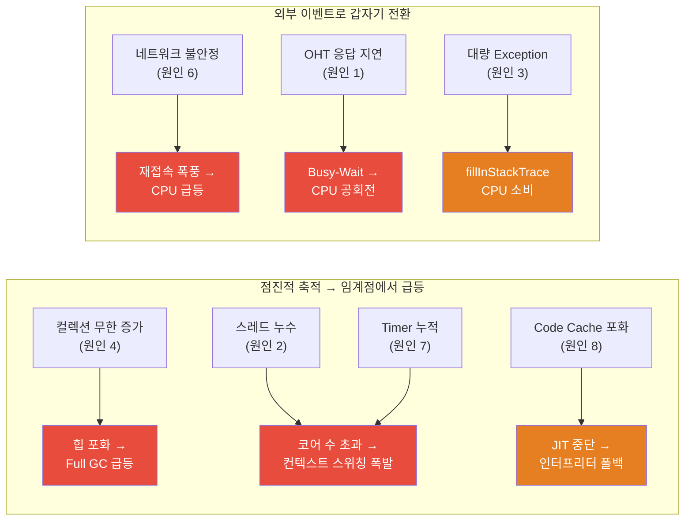

# OCS-OHT 시스템 CPU 상승 추가 원인 분석

> **대상 시스템**: OCS — OHT 100대, 1:1 Thread, 200ms 주기 TCP 통신  
> **범위**: String.format() / GC 외에 CPU 상승을 유발할 수 있는 모든 요소

---

## 요약: 추가 원인 후보 전체 목록

| 순위 | 원인 | 위험도 | "갑자기 급등" 패턴 설명 가능 |
|---|---|---|---|
| **1** | Socket Read에서 Busy-Wait (CPU 공회전) | 🔴 매우 높음 | ✅ |
| **2** | 스레드 누수 (재접속 시 기존 Thread 미종료) | 🔴 매우 높음 | ✅ |
| **3** | 빈번한 Exception 생성 (StackTrace 비용) | 🔴 높음 | ✅ |
| **4** | 무한 증가하는 컬렉션 (Map, List) | 🟡 높음 | ✅ |
| **5** | Logger Lock 경합 + 동기 I/O | 🟡 중간 | ⚠️ 부분적 |
| **6** | OHT 재접속 폭풍 (Reconnection Storm) | 🟡 중간 | ✅ |
| **7** | Timer/Scheduler 누적 | 🟡 중간 | ✅ |
| **8** | JVM Code Cache 포화 | 🟡 중간 | ✅ |

---

## 원인 1: Socket Read에서 Busy-Wait (CPU 공회전)

### 🔴 위험도: 매우 높음 — 가장 흔한 TCP 서버 CPU 문제

#### 문제 패턴

```java
// ❌ 위험한 패턴: non-blocking 또는 timeout=0으로 읽기
while (running) {
    int available = inputStream.available();  // 항상 0 반환 가능
    if (available > 0) {
        inputStream.read(buffer);
        processPacket(buffer);
    }
    // else: 데이터 없으면 아무것도 안 하고 즉시 다시 루프
    //       → CPU를 놓지 않고 계속 회전 (Busy-Wait)
}
```

```java
// ❌ 또 다른 위험 패턴: setSoTimeout(1) 같은 극단적 짧은 타임아웃
socket.setSoTimeout(1);  // 1ms timeout
while (running) {
    try {
        inputStream.read(buffer);
    } catch (SocketTimeoutException e) {
        // 1ms마다 Exception 발생 → 초당 1,000회 예외 생성
        continue;
    }
}
```

#### 왜 "갑자기" 일어날 수 있는가?

- 정상 상태: 200ms마다 데이터가 오니까 루프가 자연스럽게 데이터를 읽고 처리
- **OHT가 일시적으로 응답을 안 보내면**: 데이터가 안 오는 동안 루프가 **공회전** 시작
- OHT 1~2대만 통신 불안정해져도 해당 스레드가 CPU를 100% 점유

#### 진단 방법

```bash
# OCS 프로세스의 스레드별 CPU 사용량 확인
top -H -p $(jps -l | grep ocs | awk '{print $1}')

# CPU를 많이 쓰는 스레드 TID 확인 후 → jstack으로 해당 스레드가 뭘 하는지 확인
jstack <PID> > /opt/ocs/logs/thread_dump.txt
```

`top -H`에서 **특정 스레드 1~2개가 CPU 90%+ 점유**하고 있다면, Busy-Wait가 원인일 가능성이 높습니다.

#### 올바른 패턴

```java
// ✅ Blocking Read: 데이터가 올 때까지 스레드가 자동 대기 (CPU 0%)
socket.setSoTimeout(5000);  // 5초 timeout (적절한 값)
while (running) {
    try {
        int bytesRead = inputStream.read(buffer);
        if (bytesRead > 0) {
            processPacket(buffer, bytesRead);
        } else if (bytesRead == -1) {
            // 연결 종료 처리
            break;
        }
    } catch (SocketTimeoutException e) {
        // 5초 동안 데이터 없음 → 하트비트 체크 등
        checkOhtAlive();
    }
}
```

---

## 원인 2: 스레드 누수 (재접속 시 기존 Thread 미종료)

### 🔴 위험도: 매우 높음

#### 문제 시나리오

```
OHT-001 접속 → Thread-001 생성
OHT-001 연결 끊김 → Thread-001 종료 안 됨 ⚠️
OHT-001 재접속 → Thread-001-new 생성

반복 시:
  Thread-001 (좀비, CPU 소비 중)
  Thread-001-new (좀비, CPU 소비 중)
  Thread-001-new-2 (좀비, CPU 소비 중)
  Thread-001-new-3 (활성)
  ...
```

100대 OHT가 각각 하루에 몇 번씩 재접속하면:

| 시간 | 실제 스레드 수 | 예상 스레드 수 |
|---|---|---|
| 시작 직후 | 100 | 100 |
| 수 시간 후 | **150~300+** | 100 |
| 1일 후 | **500+** | 100 |

#### 왜 "갑자기" 급등하는가?

- 좀비 스레드가 점진적으로 쌓이다가, **CPU 코어 수를 초과하는 활성 스레드**에 도달하면 컨텍스트 스위칭이 급격히 증가
- 또는 좀비 스레드가 소켓이 닫힌 상태에서 **Exception을 계속 발생**시키며 CPU 소비

#### 진단 방법

```bash
# 현재 스레드 수 확인
jstack <PID> | grep "Thread-" | wc -l

# OHT 관련 스레드 수만 확인 (스레드 이름 패턴에 따라 조정)
jstack <PID> | grep -i "oht" | wc -l

# 시간별 스레드 수 변화 모니터링 (30초 간격)
while true; do
    echo "$(date): $(jstack <PID> 2>/dev/null | grep 'java.lang.Thread.State' | wc -l) threads"
    sleep 30
done
```

**스레드 수가 100보다 훨씬 많고 시간이 지날수록 증가하면**, 스레드 누수가 확정됩니다.

---

## 원인 3: 빈번한 Exception 생성 (StackTrace 비용)

### 🔴 위험도: 높음 — 종종 간과되는 CPU 킬러

#### 왜 Exception이 비싼가?

```java
// Exception 생성 시 내부 동작:
new SomeException("message");
    → Throwable.fillInStackTrace()  // ⚠️ Native 메서드
        → 현재 스레드의 전체 Call Stack을 탐색
        → StackTraceElement[] 배열 생성
        → 프레임당 클래스명, 메서드명, 파일명, 라인번호 추출
```

**Exception 1개 생성 비용: ~5~50 μs** (일반 객체 생성의 100~1,000배)

#### OCS에서 발생할 수 있는 시나리오

```java
// 시나리오 A: 짧은 소켓 타임아웃으로 인한 대량 예외
socket.setSoTimeout(100);  // 100ms timeout
while (running) {
    try {
        read(buffer);
    } catch (SocketTimeoutException e) {
        // 200ms 주기인데 100ms timeout → 매 주기마다 1회 예외
        // 100 OHT × 5회/초 = 초당 500회 SocketTimeoutException
        log.debug("timeout", e);  // ⚠️ e의 stacktrace도 로깅하면 더 심각
    }
}

// 시나리오 B: 패킷 파싱 중 예외 처리
try {
    int value = Integer.parseInt(hexString);  // 잘못된 데이터
} catch (NumberFormatException e) {
    // 파싱 실패할 때마다 Exception 생성
}

// 시나리오 C: 연결 끊긴 소켓에 계속 쓰기 시도
try {
    outputStream.write(response);
} catch (IOException e) {
    // 재접속 전까지 매 시도마다 Exception
}
```

#### 핵심: "갑자기" 급등하는 이유

- 정상 시: Exception 거의 없음
- **OHT 다수가 동시에 통신 불안정** (네트워크 문제, OHT 일괄 재부팅 등):
  → 순간적으로 **초당 수천 개의 Exception** 생성
  → 각 Exception마다 fillInStackTrace() 실행
  → **CPU 급등**

#### 진단 방법

```bash
# OCS 로그에서 Exception 빈도 확인
grep -c "Exception" /opt/ocs/logs/ocs.log

# 시간대별 Exception 빈도
grep "Exception" /opt/ocs/logs/ocs.log | awk '{print substr($1,1,13)}' | uniq -c | sort -rn | head -20

# 가장 많이 발생하는 Exception 유형
grep -oP '\w+Exception' /opt/ocs/logs/ocs.log | sort | uniq -c | sort -rn | head -10
```

---

## 원인 4: 무한 증가하는 컬렉션 (Map, List)

### 🟡 위험도: 높음

#### 문제 패턴

```java
// OHT 상태 이력 관리 (흔한 패턴)
private Map<Integer, List<OhtStatus>> statusHistory = new HashMap<>();

public void onStatusReceived(int ohtId, OhtStatus status) {
    statusHistory.computeIfAbsent(ohtId, k -> new ArrayList<>())
                 .add(status);  // ⚠️ 제거 로직 없이 계속 추가
}

// 통신 로그 보관
private List<CommLog> commLogs = new ArrayList<>();

public void onPacketReceived(byte[] data) {
    commLogs.add(new CommLog(data));  // ⚠️ 무한 증가
}
```

#### 시간에 따른 누적

| 경과 시간 | List 크기 (100 OHT × 5/초) | 예상 메모리 |
|---|---|---|
| 1시간 | 1,800,000 | ~150~300 MB |
| 4시간 | 7,200,000 | ~600 MB~1.2 GB |
| 8시간 | 14,400,000 | **~1.2~2.4 GB → OOM 위험** |

#### CPU와의 관계

- 컬렉션이 커지면 → **힙 메모리 포화** → **Full GC 빈발** → CPU 급등
- ArrayList 내부 배열 resize 시 전체 복사 → CPU 스파이크
- HashMap rehash (용량 초과 시) → 대량 연산

#### 진단 방법

```bash
# 힙 덤프 후 가장 큰 객체 확인
jmap -histo:live <PID> | head -30

# 결과에서 주목할 항목:
# - [C (char[])       : String 내부 배열, 비정상적으로 많으면 문자열 누수
# - [B (byte[])       : 바이트 배열, 패킷 데이터 누적 의심
# - java.util.HashMap$Node : Map entry 누적
# - java.util.ArrayList    : List 누적
```

---

## 원인 5: Logger Lock 경합 + 동기 I/O

### 🟡 위험도: 중간

```
100개 Thread가 동시에 logger.debug() 호출
    ↓
Logger 내부 synchronized 블록에서 경합
    ↓
대기 중인 스레드: CPU 컨텍스트 스위칭 발생
    ↓
파일 I/O flush: 디스크 대기 시간 동안 lock 유지
    ↓
다른 99개 스레드 추가 대기
```

#### 악화 조건

- **로그 파일이 수 GB로 커진 경우**: 파일 시스템 성능 저하
- **디스크 I/O가 느린 환경**: NFS, 네트워크 드라이브 등
- **로그 레벨이 DEBUG**: 초당 1,500줄+ 쓰기

#### 진단 방법

```bash
# 로그 파일 크기 확인
ls -lh /opt/ocs/logs/

# 디스크 I/O 상태 확인
iostat -x 1 5

# await(평균 대기시간)이 높으면 디스크 병목
# %util이 100%에 가까우면 디스크 포화
```

---

## 원인 6: OHT 재접속 폭풍 (Reconnection Storm)

### 🟡 위험도: 중간

#### 시나리오

```
정상 상태: 100대 OHT 안정 연결, CPU 10%

갑자기 네트워크 불안정 발생:
  → OHT 30대 동시 연결 끊김
  → 30개 스레드가 동시에 cleanup + reconnect 시도
  → 새 소켓 생성, SSL 핸드셰이크(있다면), 초기화 로직 실행
  → 기존 스레드 종료 + 새 스레드 생성 (스레드 누수 없더라도 부하)
  → 재접속 후 밀린 status 메시지 한꺼번에 수신
  → CPU 급등
```

#### "급등 후 유지" 패턴이 되려면

- 재접속 ↔ 끊김이 **반복**(flapping)되는 경우
- 재접속 시도가 **즉시 재시도(no backoff)**로 구현된 경우:

```java
// ❌ 위험: 연결 실패 시 즉시 재시도 → CPU 공회전
while (running) {
    try {
        socket = new Socket(ohtIp, ohtPort);
        handleConnection(socket);
    } catch (IOException e) {
        // 연결 실패 → 바로 다시 시도 (sleep 없음!)
        log.error("Connection failed, retrying...");
    }
}
```

#### 올바른 패턴

```java
// ✅ Exponential Backoff
int retryDelay = 1000;  // 1초부터 시작
int maxDelay = 30000;   // 최대 30초

while (running) {
    try {
        socket = new Socket(ohtIp, ohtPort);
        retryDelay = 1000;  // 성공 시 리셋
        handleConnection(socket);
    } catch (IOException e) {
        log.error("Connection failed, retry in {}ms", retryDelay);
        Thread.sleep(retryDelay);
        retryDelay = Math.min(retryDelay * 2, maxDelay);
    }
}
```

---

## 원인 7: Timer / ScheduledExecutor 누적

### 🟡 위험도: 중간

#### 문제 패턴

```java
// OHT 연결 시 타이머 등록
public void onOhtConnected(int ohtId) {
    // ❌ 재접속마다 새 Timer 생성, 이전 것을 cancel 안 함
    Timer timer = new Timer("heartbeat-" + ohtId);
    timer.scheduleAtFixedRate(new HeartbeatTask(ohtId), 0, 1000);
}

// 또는 ScheduledExecutorService
public void onOhtConnected(int ohtId) {
    // ❌ 이전 ScheduledFuture를 cancel하지 않고 새로 등록
    scheduler.scheduleAtFixedRate(() -> sendHeartbeat(ohtId), 0, 1, TimeUnit.SECONDS);
}
```

- 재접속마다 타이머가 누적 → 시간이 지날수록 실행되는 Task 수 증가
- 각 Task가 CPU를 소비 → 점진적 CPU 상승 후 특정 임계점에서 급등

---

## 원인 8: JVM Code Cache 포화

### 🟡 위험도: 중간

#### 메커니즘

```
JIT 컴파일러가 hot method를 네이티브 코드로 컴파일
    → Code Cache에 저장
    → Code Cache 기본 크기: 240MB (JDK 8, 64bit)

Code Cache가 가득 차면:
    → JIT 컴파일 중단
    → 이미 컴파일된 코드가 역최적화(deoptimized)될 수 있음
    → 인터프리터 모드로 폴백 → CPU 급등
```

#### 진단 방법

```bash
# Code Cache 사용량 확인
jcmd <PID> Compiler.codecache

# 또는 JVM 옵션 추가로 Code Cache 이벤트 로깅
-XX:+PrintCodeCache
-XX:+PrintCompilation
```

---

## 종합 진단 체크리스트

코드 없이도 **아래 명령어들로 원인을 좁힐 수 있습니다**:

### Step 1: 어디서 CPU를 쓰는지 확인

```bash
# 스레드별 CPU 사용량 확인 (가장 중요!)
top -H -p <PID>
```

| 관찰 결과 | 추정 원인 |
|---|---|
| **특정 1~2개 스레드가 CPU 90%+** | → Busy-Wait (원인 1) |
| **모든 스레드가 고르게 CPU 사용** | → GC 또는 전체적 부하 |
| **GC 스레드가 CPU 최상위** | → Full GC (기존 분석 내용) |
| **스레드 수가 100보다 훨씬 많음** | → 스레드 누수 (원인 2) |

### Step 2: 스레드 상태 확인

```bash
# Thread Dump 수집 (CPU 급등 시 3~5회, 5초 간격)
for i in 1 2 3 4 5; do
    echo "=== Dump $i ===" >> /opt/ocs/logs/thread_dump.txt
    jstack <PID> >> /opt/ocs/logs/thread_dump.txt 2>&1
    sleep 5
done
```

| 관찰 결과 | 추정 원인 |
|---|---|
| 같은 스레드가 매번 **같은 위치**(소켓 read)에서 RUNNABLE | → Busy-Wait |
| 다수 스레드가 **BLOCKED** (Logger lock 대기) | → 로그 I/O 경합 |
| 다수 스레드가 catch 블록에서 RUNNABLE | → Exception 폭풍 |
| 예상보다 **스레드 수가 많음** | → 스레드 누수 또는 Timer 누적 |

### Step 3: 기타 확인

```bash
# Exception 빈도 확인
grep -c "Exception" /opt/ocs/logs/ocs.log

# 힙 객체 분포 확인 (메모리 누수)
jmap -histo:live <PID> | head -30

# 디스크 I/O 확인
iostat -x 1 5
```

---

## 원인별 "갑자기 급등 후 유지" 설명 가능 여부



> [!TIP]
> **가장 빠른 원인 특정 방법**: CPU가 급등한 상태에서 `top -H -p <PID>`를 실행하세요.
> - **특정 스레드가 CPU 독점** → Busy-Wait 또는 재접속 루프
> - **GC 스레드가 상위** → Full GC (힙 문제)
> - **골고루 분산** → 전반적 부하 증가 (스레드 누수, Exception 등)
>
> 이 한 가지 확인만으로 원인의 범주를 즉시 좁힐 수 있습니다.
