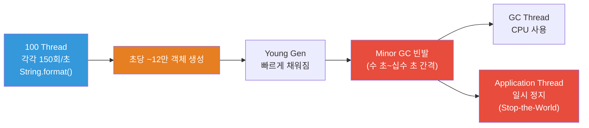
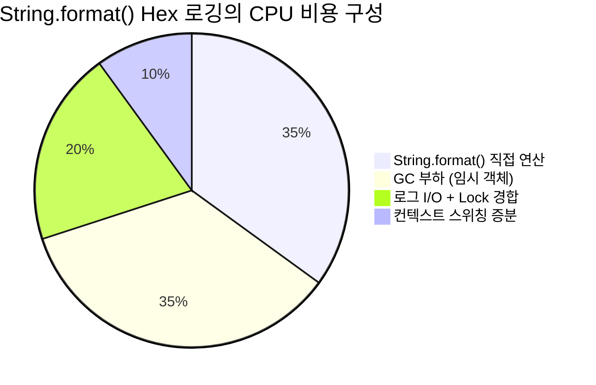

# OCS–OHT TCP 통신 환경에서 `String.format()` Hex 로깅의 CPU 사용량 영향 분석

> **작성일**: 2026-06-01  
> **대상 시스템**: OCS (Overhead Controller System) — OHT (Overhead Hoist Transport) TCP 통신  
> **분석 범위**: `String.format()`을 이용한 hex 로깅이 CPU 사용량 상승의 원인인지 여부

---

## 1. 분석 대상 시스템 조건

| 항목 | 조건 |
|---|---|
| OCS–OHT 통신 구조 | OHT 1대당 전담 Thread 1개 (1:1 매핑) |
| 관리 OHT 수 | **100대** → OCS 내 **100개 Thread** 상시 가동 |
| 메시지 수신 주기 | **200ms** 간격 (초당 5회/OHT) |
| 패킷 크기 | **30 bytes** |
| 로깅 방식 | 10 byte 단위로 분할하여 hex string 정렬 로깅 |
| hex 변환 방법 | `String.format("%02X", byte)` 바이트 단위 호출 |

---

## 2. 호출 빈도 정량 분석

### 2.1 `String.format()` 호출 횟수 산출

수신 패킷 1건(30바이트)의 처리 과정을 단계별로 분석합니다.

```
30 byte 패킷 수신
 ├─ [Chunk 1] 1~10 byte → loop 10회: String.format("%02X", b) × 10
 ├─ [Chunk 2] 11~20 byte → loop 10회: String.format("%02X", b) × 10
 └─ [Chunk 3] 21~30 byte → loop 10회: String.format("%02X", b) × 10
```

추정되는 코드 패턴:

```java
// OHT 전담 스레드 내 수신 처리부
public void onPacketReceived(byte[] data) {  // data.length = 30
    for (int offset = 0; offset < data.length; offset += 10) {
        StringBuilder sb = new StringBuilder();
        int end = Math.min(offset + 10, data.length);
        for (int i = offset; i < end; i++) {
            sb.append(String.format("%02X ", data[i]));  // ⚠️ 바이트마다 호출
        }
        logger.debug(sb.toString());  // 10바이트씩 한 줄로 출력
    }
}
```

#### 호출 횟수 계산

```
┌──────────────────────────────────────────────────────────────┐
│  패킷 1건당 String.format() 호출                              │
│  = 30 bytes ÷ 1 byte/호출 = 30회                              │
│                                                              │
│  OHT 1대당 초당 호출                                           │
│  = 30회/패킷 × 5 패킷/초 = 150회/초                            │
│                                                              │
│  전체 시스템 초당 호출 (OHT 100대)                               │
│  = 150회 × 100 = 15,000회/초                                   │
└──────────────────────────────────────────────────────────────┘
```

| 단위 | String.format() 호출 횟수 |
|---|---|
| 패킷 1건 (30 bytes) | **30회** |
| OHT 1대 / 초 | **150회** |
| OHT 100대 / 초 | **15,000회** |
| OHT 100대 / 분 | **900,000회** |
| OHT 100대 / 시간 | **54,000,000회** |

---

## 3. `String.format("%02X", b)` 1회 호출 시 내부 동작

### 3.1 호출 체인

`String.format("%02X", b)` 한 번의 호출로 JVM 내부에서 일어나는 일:

```mermaid
graph TD
    A["String.format(\"%02X\", b)"] --> B["1. byte → Byte autoboxing"]
    B --> C["2. new Object[]{Byte} 배열 생성"]
    C --> D["3. new Formatter(new StringBuilder()) 생성"]
    D --> E["4. format string \"%02X\" regex 파싱"]
    E --> F["5. FormatSpecifier 객체 생성"]
    F --> G["6. Byte → int 변환 + hex 변환"]
    G --> H["7. 패딩/대문자 처리"]
    H --> I["8. 결과 String 객체 생성"]
    I --> J["9. Formatter, StringBuilder 등<br/>임시 객체 GC 대상화"]
    
    style A fill:#e74c3c,color:#fff
    style E fill:#e67e22,color:#fff
    style J fill:#e74c3c,color:#fff
```

### 3.2 1회 호출당 생성되는 임시 객체

| 객체 | 용도 | GC 대상 |
|---|---|---|
| `Byte` | primitive `byte`의 autoboxing | ✅ |
| `Object[]` | 가변 인자 배열 | ✅ |
| `Formatter` | 포맷 처리 엔진 | ✅ |
| `StringBuilder` | Formatter 내부 출력 버퍼 | ✅ |
| `char[]` | StringBuilder 내부 배열 | ✅ |
| `Matcher` | regex 매칭 결과 | ✅ |
| `FormatSpecifier` | 파싱된 포맷 지시자 | ✅ |
| `String` (결과) | `"0A "` 같은 최종 결과 | sb.append()에 사용 후 GC |

> **1회 호출당 약 7~8개의 임시 객체 생성**

### 3.3 Format String 파싱의 비효율

> [!IMPORTANT]
> **`String.format()`은 format string `"%02X"`를 캐싱하지 않습니다.** 동일한 format string이라도 매 호출마다 처음부터 regex 파싱을 반복합니다.

```java
// OpenJDK java.util.Formatter 내부
private static final String formatSpecifier =
    "%(\\d+\\$)?([-#+ 0,(\\<]*)?(\\d+)?(\\.\\d+)?([tT])?([a-zA-Z%])";
private static final Pattern fsPattern = Pattern.compile(formatSpecifier);

// 매 호출 시 실행:
Matcher m = fsPattern.matcher(formatString);  // regex 매칭 반복
```

`"%02X"` 3글자를 해석하기 위해 6개의 캡처 그룹을 가진 정규표현식이 매번 실행됩니다.

---

## 4. 시스템 전체 부하 영향 분석

### 4.1 직접 CPU 소비량

`String.format("%02X", b)` 1회 실행 시간은 JMH 벤치마크 기준 약 **1.5~2.5 μs** (마이크로초)입니다.

```
초당 15,000회 × 2.0 μs/회 = 30,000 μs = 30 ms/초
```

| 항목 | 값 |
|---|---|
| String.format() 순수 CPU 시간 | **~30 ms/초** |
| 단일 CPU 코어 점유율 환산 | **~3%** |

> [!NOTE]
> 순수 연산 비용만 보면 **단일 코어의 약 3%** 로, 이것만으로는 심각한 CPU 문제라고 보기 어렵습니다. 그러나 아래 간접 비용을 함께 고려해야 합니다.

### 4.2 간접 비용: GC (Garbage Collection) 부하

#### 초당 임시 객체 생성량

```
15,000회/초 × 7~8 객체/회 = 105,000~120,000 객체/초
```

| 항목 | 값 |
|---|---|
| 초당 임시 객체 수 | **~105,000~120,000개** |
| 분당 임시 객체 수 | **~6,300,000~7,200,000개** |
| 객체당 평균 크기 (추정) | ~40~80 bytes |
| 초당 할당 메모리 (추정) | **~4.2~9.6 MB/초** |



> [!WARNING]
> 초당 ~12만 개의 단명(short-lived) 객체가 생성되어 **Young Generation GC가 빈번하게 발생**합니다.  
> GC 자체가 CPU를 소비하며, Stop-the-World pause 동안 **100개의 OHT 스레드가 모두 일시 정지**되어 200ms 주기의 메시지 처리에 지터(jitter)를 유발할 수 있습니다.

#### GC의 CPU 기여도 추정

- Young GC 1회 소요 시간: 일반적으로 5~20ms
- Young Gen 크기에 따라 수 초 ~ 십수 초 간격으로 발생
- GC 스레드는 보통 CPU 코어 수에 비례 (ParallelGC 기준)
- **GC로 인한 추가 CPU 사용: 평균 1~5%** (힙 크기, GC 알고리즘에 따라 편차)

### 4.3 간접 비용: 100 스레드 컨텍스트 스위칭

| 항목 | 영향 |
|---|---|
| 스레드 수 | 100개 (OHT 전담) + GC 스레드 + 로그 I/O 스레드 등 |
| 컨텍스트 스위치 비용 | ~1~10 μs/회 (캐시 미스 포함 시 더 높음) |
| 로그 쓰기 시 I/O 대기 | 스레드 sleep → 깨어남 → 컨텍스트 스위치 |

100개 스레드가 200ms마다 깨어나서 패킷 수신 → String.format() 루프 → 로그 I/O를 수행하므로, **로깅으로 인한 컨텍스트 스위칭이 증가**합니다.

### 4.4 간접 비용: 로그 I/O 경합

```java
// 100개 스레드가 동시에 로그 출력
logger.debug(hexLine);  // 내부적으로 동기화(lock) 발생 가능
```

- 패킷 1건당 **3줄의 로그** 출력 (10바이트씩 3줄)
- 초당 총 로그 출력: 100 OHT × 5 패킷 × 3줄 = **1,500 로그 라인/초**
- 동기 로깅 시 100개 스레드가 Logger의 lock을 놓고 경합
- 파일 I/O flush 빈도에 따라 추가 지연

---

## 5. 종합 CPU 영향 평가

### 5.1 비용 항목별 기여도 정리

```
┌─────────────────────────────────────────────────────────────────┐
│                    CPU 사용량 기여 요인 분해                       │
├──────────────────────────┬────────────────┬─────────────────────┤
│ 요인                      │ 추정 CPU 기여도 │ 비고                 │
├──────────────────────────┼────────────────┼─────────────────────┤
│ String.format() 직접 연산  │ ~3%            │ regex 파싱, 문자열 생성 │
│ GC (임시 객체 회수)         │ ~1~5%          │ 12만 객체/초, Minor GC │
│ 로그 I/O + Lock 경합       │ ~1~3%          │ 1,500 라인/초, 100 Thread│
│ 컨텍스트 스위칭 증분        │ ~0.5~1%        │ 로그로 인한 추가 스위칭  │
├──────────────────────────┼────────────────┼─────────────────────┤
│ 합계                      │ ~5.5~12%       │ 단일 코어 기준         │
└──────────────────────────┴────────────────┴─────────────────────┘
```

### 5.2 결론



> [!IMPORTANT]
> ### 판정: `String.format()`은 CPU 사용량 상승에 **기여하는 원인**입니다.
>
> 다만, 현재 조건(OHT 100대, 200ms 주기, 30바이트 패킷)에서 **단독으로 심각한 CPU 문제를 일으킬 수준은 아닙니다.**  
> 추정 기여도는 **단일 코어 기준 약 5~12%** 이며, 이는 쿼드코어 기준 전체 CPU의 **약 1.5~3%** 에 해당합니다.
>
> 그러나 다음 조건에서는 **문제가 악화**될 수 있습니다:
> - OHT 대수 증가 (200대, 300대...)
> - 패킷 크기 증가 또는 수신 주기 단축
> - 로그 레벨이 DEBUG로 설정된 상태의 장기 운영
> - JVM 힙 크기가 작게 설정된 경우 (GC 빈발)
> - 다른 로깅/문자열 처리와 중첩될 경우

---

## 6. CPU 상승 원인이 되는 구체적 이유 정리

### 이유 1: Format String의 비효율적 반복 파싱

```java
// 이 한 줄이 30바이트 패킷마다 30번 실행됨
sb.append(String.format("%02X ", data[i]));
```

`"%02X"` 는 3글자의 단순한 포맷이지만, 매 호출마다:
1. `java.util.Formatter` 인스턴스를 새로 생성
2. 6개의 캡처 그룹을 가진 정규표현식으로 `"%02X"`를 파싱
3. `FormatSpecifier` 객체를 생성하여 `0`(패딩), `2`(너비), `X`(hex 대문자) 추출
4. 결과 String 객체 생성 후 Formatter 폐기

**하고 싶은 일**: `byte → 2자리 hex 문자` (단순 변환)  
**실제 하는 일**: 범용 포맷 엔진 전체를 매번 기동하여 regex 파싱을 수행

> 이는 **못을 박기 위해 매번 중장비를 동원하는 것**과 같은 비효율입니다.

### 이유 2: 대량 임시 객체 생성으로 인한 GC 압력

| 30바이트 패킷 1건 처리 시 | 값 |
|---|---|
| `String.format()` 호출 횟수 | 30회 |
| 생성되는 임시 객체 수 | **~210~240개** |
| 전체 시스템 초당 임시 객체 | **~105,000~120,000개** |

이 객체들은 모두 극도로 짧은 수명(생성 후 즉시 미참조)을 가지므로 Young Generation에 쌓이고, Minor GC를 빈번하게 트리거합니다.

### 이유 3: 100개 스레드의 동시 로깅 경합

```
Thread-OHT-001 ─┐
Thread-OHT-002 ─┤
Thread-OHT-003 ─┤ 동시에 logger.debug() 호출
     ...        ├─── Logger 내부 synchronized 블록 경합
Thread-OHT-099 ─┤     → 스레드 대기 → 컨텍스트 스위치
Thread-OHT-100 ─┘
```

100개 스레드가 각각 200ms 주기로 3줄의 로그를 쓰면, **초당 1,500회의 로그 쓰기**가 발생합니다. 동기 로거를 사용할 경우 Logger 내부의 lock 경합으로 인해 스레드 대기 시간이 발생하고, 이는 컨텍스트 스위칭 비용으로 전환됩니다.

### 이유 4: 불필요한 연산의 상시 수행

프로덕션 환경에서 로그 레벨을 INFO 이상으로 설정해도, Guard Clause가 없으면 **hex 변환은 항상 수행**됩니다:

```java
// ❌ 로그 레벨이 INFO여도 String.format() 30회 + StringBuilder 연산은 실행됨
logger.debug(String.format("Received: %s", toHexString(data)));
```

이 경우 최종적으로 로그가 출력되지는 않지만, **문자열 생성과 포맷팅에 소비된 CPU와 메모리는 이미 낭비**된 상태입니다.

---

## 7. 최적화 권장사항

### 7.1 즉시 적용 (1순위): Lookup Table 방식으로 교체

```java
private static final char[] HEX = "0123456789ABCDEF".toCharArray();

/**
 * 30바이트 패킷을 10바이트 단위로 정렬된 hex string으로 변환
 * String.format() 대비 약 20~40배 빠름
 */
public static String toFormattedHex(byte[] data, int offset, int length) {
    char[] buf = new char[length * 3];  // "XX " 형식, 한 바이트당 3문자
    for (int i = 0; i < length; i++) {
        int v = data[offset + i] & 0xFF;
        buf[i * 3]     = HEX[v >>> 4];
        buf[i * 3 + 1] = HEX[v & 0x0F];
        buf[i * 3 + 2] = ' ';
    }
    return new String(buf);
}

// 사용 예
public void onPacketReceived(byte[] data) {
    if (!logger.isDebugEnabled()) return;  // ← Guard Clause

    for (int offset = 0; offset < data.length; offset += 10) {
        int len = Math.min(10, data.length - offset);
        logger.debug(toFormattedHex(data, offset, len));
    }
}
```

**개선 효과:**

| 항목 | String.format() 방식 | Lookup Table 방식 | 개선율 |
|---|---|---|---|
| 패킷당 임시 객체 | ~210~240개 | **~6개** (char[] 3 + String 3) | **97% 감소** |
| 초당 임시 객체 (100 OHT) | ~120,000개 | **~3,000개** | **97% 감소** |
| 패킷당 소요시간 (추정) | ~45~75 μs | **~1.5~3 μs** | **95% 감소** |
| GC 빈도 | 수 초~십수 초 간격 | 대폭 감소 | — |

### 7.2 즉시 적용 (1순위): Guard Clause 추가

```java
// String.format() 사용 여부와 무관하게 반드시 적용
if (logger.isDebugEnabled()) {
    // hex 변환 및 로깅 수행
}
```

> [!TIP]
> 프로덕션에서 로그 레벨이 INFO 이상이라면, **이 한 줄만으로 hex 로깅 관련 CPU 사용량이 0으로** 줄어듭니다.

### 7.3 Java 17+ 환경: `HexFormat` 사용

```java
import java.util.HexFormat;

private static final HexFormat HEX_FORMAT = HexFormat.ofDelimiter(" ").withUpperCase();

public void onPacketReceived(byte[] data) {
    if (!logger.isDebugEnabled()) return;

    for (int offset = 0; offset < data.length; offset += 10) {
        int len = Math.min(10, data.length - offset);
        byte[] chunk = Arrays.copyOfRange(data, offset, offset + len);
        logger.debug(HEX_FORMAT.formatHex(chunk));
    }
}
```

### 7.4 추가 권장: 비동기 로깅

100개 스레드의 로그 I/O 경합을 해소하기 위해 비동기 로깅을 권장합니다:

```xml
<!-- Log4j2 AsyncAppender 설정 -->
<Async name="AsyncDebugLog" bufferSize="1024">
    <AppenderRef ref="PacketLogFile"/>
</Async>
```

또는 Logback의 `AsyncAppender`를 사용합니다.

---

## 8. 최종 요약

### 8.1 "String.format()이 CPU 사용량 상승의 원인인가?"

| 질문 | 답변 |
|---|---|
| CPU 사용량 상승에 기여하는가? | ✅ **예** |
| 단독으로 심각한 문제를 일으키는 수준인가? | ⚠️ **현 조건에서는 단독 주범이라고 보기는 어려움** |
| 최적화해야 하는가? | ✅ **예, 반드시 권장** |

### 8.2 원인 요약 (4가지)

```
  ① 비효율적 반복 파싱      ──→  매 호출마다 regex로 "%02X" 재해석, 캐싱 없음
  ② 임시 객체 폭발          ──→  호출당 7~8개 객체, 초당 12만 개 → GC 부하
  ③ 100 Thread 로그 경합    ──→  동기 Logger lock 경합 → 컨텍스트 스위칭
  ④ 불필요한 연산 상시 수행   ──→  Guard Clause 없이 비활성 로그에도 변환 실행
```

### 8.3 적용 우선순위

| 순위 | 조치 | 예상 효과 | 난이도 |
|---|---|---|---|
| **1** | Guard Clause 추가 (`isDebugEnabled()`) | 프로덕션에서 관련 CPU 0%로 제거 | ⭐ 매우 쉬움 |
| **1** | String.format() → Lookup Table 교체 | 변환 속도 **20~40배 향상**, GC 97% 감소 | ⭐ 쉬움 |
| **2** | 비동기 로깅 적용 | I/O 경합 제거, 스레드 blocking 해소 | ⭐⭐ 보통 |
| **3** | 30바이트 전체를 한번에 변환 (루프 제거) | 함수 호출 오버헤드 추가 감소 | ⭐ 매우 쉬움 |

> [!TIP]
> **1순위 두 가지만 적용하면 String.format() 로깅으로 인한 CPU 기여분을 사실상 제거**할 수 있습니다. OHT 대수가 증가하거나 메시지 주기가 짧아질 경우를 대비하여, 조기에 적용하는 것을 권장합니다.

---

*본 보고서는 Java(OpenJDK) 기반의 OCS 시스템을 전제로 작성되었습니다. JVM 버전, GC 알고리즘(G1, ZGC 등), 힙 크기 설정, 로깅 프레임워크 종류에 따라 실제 수치는 달라질 수 있습니다.*
