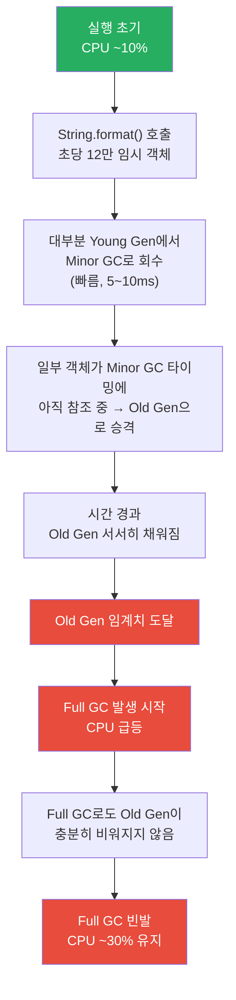

# OCS CPU 사용량 "10% → 30% 급등 후 유지" 현상 원인 분석

> **작성일**: 2026-06-01  
> **현상**: OCS 실행 초기 CPU ~10% 유지 → 일정 시간 후 갑자기 ~30%+ 급등 → 이후 30% 상태 지속

---

## 1. 핵심 판단

### `String.format()`만으로 이 현상을 설명할 수 있는가?

> [!IMPORTANT]
> **아니오.** `String.format()`은 **일정한(constant) 오버헤드**를 발생시키는 요인이므로, "갑자기 급등 후 유지"라는 패턴과 맞지 않습니다.

#### 그 이유

```
String.format()이 원인이라면 예상되는 CPU 패턴:

CPU%
30|
25|
20|  ───────────────────────────────    ← 처음부터 일정하게 높음
15|
10|
 5|
  └──────────────────────────────── 시간 →
   0     1h     2h     3h     4h

실제 관측된 CPU 패턴:

CPU%
30|                  ┌──────────────    ← 어느 순간 급등 후 유지
25|                  │
20|                  │
15|                  │
10|  ────────────────┘                  ← 초기에는 정상
 5|
  └──────────────────────────────── 시간 →
   0     1h     2h     3h     4h
```

- `String.format()`은 **OHT 100대가 연결된 순간부터 즉시** 초당 15,000회 호출을 시작합니다.
- 만약 이것이 원인이라면, CPU는 **실행 초기부터** 높아야 합니다.
- "일정 시간 후 갑자기" 올라가는 현상은 **시간 경과에 따라 상태가 바뀌는 다른 요인**이 존재한다는 것을 의미합니다.

단, `String.format()`은 **아래에서 설명할 진짜 원인을 유발하거나 악화시키는 간접적 기여 요인**일 수 있습니다.

---

## 2. "10% → 30% 급등" 패턴을 설명할 수 있는 실제 원인 후보

### 원인 후보 요약

| 순위 | 원인 | 가능성 | String.format()과의 관계 |
|---|---|---|---|
| **1** | **GC 레짐 전환 (Minor → Full GC)** | 🔴 매우 높음 | 임시 객체가 Old Gen 누적을 가속 |
| **2** | **메모리 누수 (로그 버퍼, 컬렉션 등)** | 🔴 높음 | 변환된 String이 어딘가에 누적될 가능성 |
| **3** | **로그 파일 비대화 + I/O 병목** | 🟡 중간 | 초당 1,500줄 로그가 파일 크기를 빠르게 증가 |
| **4** | **JIT 역최적화 (Deoptimization)** | 🟡 중간 | 간접적 |
| **5** | **Thread 수 동적 증가** | 🟡 중간 | 무관 |

---

### 원인 1 (최유력): GC 레짐 전환 — Minor GC에서 Full GC로

> [!CAUTION]
> **가장 가능성이 높은 원인입니다.** `String.format()`이 생성하는 대량의 임시 객체가 이 현상의 **트리거**가 될 수 있습니다.

#### 발생 메커니즘



#### 왜 "갑자기" 일어나는가?

```
JVM Heap 상태 변화:

시간 0h~Xh (정상 구간):
┌─────────────────────────────────────────┐
│ Young Gen     │        Old Gen          │
│ [████░░░░░░░] │ [██░░░░░░░░░░░░░░░░░░] │
│  Minor GC로   │  천천히 채워짐            │
│  빠르게 회수   │                          │
└─────────────────────────────────────────┘
→ CPU ~10%: Minor GC만 발생, 빠르고 가벼움

시간 Xh 이후 (급등 시점):
┌─────────────────────────────────────────┐
│ Young Gen     │        Old Gen          │
│ [████░░░░░░░] │ [██████████████████░░░] │
│               │  ↑ 임계치(75%) 도달!     │
│               │  → Full GC 시작          │
└─────────────────────────────────────────┘
→ CPU ~30%: Full GC 반복, 전체 힙 스캔, Stop-the-World 길어짐
```

**핵심 포인트:**
- 100개 스레드가 동시에 `String.format()`을 실행하고 있으면, Minor GC 시점에 **스택에서 참조 중인 임시 객체가 회수되지 못하고 Old Gen으로 승격**됩니다.
- Old Gen은 서서히 차오르다가 **임계치를 넘는 순간 Full GC가 트리거**됩니다.
- Full GC는 Minor GC보다 **10~100배 느리고** CPU를 많이 사용합니다.
- Old Gen이 계속 빠르게 차오르면 Full GC가 반복 발생하여 **30%대 CPU가 유지**됩니다.

#### String.format()과의 관계

| 역할 | 설명 |
|---|---|
| 직접 원인인가? | ❌ String.format() 자체가 갑자기 더 느려지는 것은 아님 |
| 간접 기여자인가? | ✅ **Old Gen을 채우는 임시 객체의 공급원**, GC 전환을 앞당김 |
| 악화 요인인가? | ✅ Full GC 중에도 계속 12만/초 객체를 생성하여 GC 부하 가중 |

---

### 원인 2: 메모리 누수 (로그 관련 객체 누적)

#### 가능한 시나리오

```java
// 시나리오 A: 로그 이벤트 객체가 큐에 쌓이는 경우
// (비동기 로거의 버퍼가 가득 차서 배압 발생)
asyncLogger.debug(hexString);  // 내부 큐에 LogEvent 누적

// 시나리오 B: 커스텀 로그 버퍼에 저장하는 경우
List<String> packetLog = new ArrayList<>();  // ⚠️ 계속 커지는 리스트
packetLog.add(toHexString(data));            // 해제하지 않으면 메모리 누수

// 시나리오 C: 통신 이력 관리 Map
Map<Integer, List<String>> ohtHistory = new HashMap<>();
ohtHistory.get(ohtId).add(hexString);  // ⚠️ 무한 증가
```

> [!WARNING]
> 코드 어딘가에서 hex 변환된 로그 문자열을 **컬렉션에 누적**하고 있다면, 이것이 **메모리 누수 → GC 급등**의 직접적 원인이 됩니다. 코드 리뷰로 확인이 필요합니다.

---

### 원인 3: 로그 파일 비대화

```
초당 로그 라인 수: 100 OHT × 5 패킷 × 3줄 = 1,500줄/초
한 줄 평균 크기: ~35 bytes ("0A 1B 2C 3D 4E 5F 6A 7B 8C 9D")

1시간 로그 크기: 1,500 × 35 × 3,600 ≈ 189 MB/시간
24시간 로그 크기: ≈ 4.5 GB/일
```

- 로그 로테이션(rotation)이 설정되어 있지 않으면, 파일이 수 GB로 커짐
- 파일 시스템 버퍼 캐시 포화 → flush I/O 지연 → 스레드 블로킹 증가
- 특정 크기를 넘으면 OS 레벨에서 I/O 패턴이 바뀔 수 있음 (sequential → random-like)

---

### 원인 4: JIT 역최적화 (Deoptimization)

- JVM은 초기에 `String.format()`을 인터프리터로 실행
- 자주 호출되면 **JIT 컴파일 → 최적화**
- 그러나 특정 조건(예: 클래스 로딩, 메타데이터 오버플로우)에서 **역최적화**가 발생하면 인터프리터로 복귀 → CPU 급등
- 보통은 다시 JIT 컴파일되어 회복되지만, 반복 역최적화가 발생할 수 있음

---

### 원인 5: Thread 수 동적 증가

- OHT가 처음부터 100대 모두 접속해 있는 것이 아니라, **시간이 지남에 따라 점진적으로 접속**하는 경우
- 또는 재접속 시 **이전 스레드를 종료하지 않고 새 스레드를 생성**하는 버그
- 이 경우 스레드 수가 100 → 200 → 300...으로 증가하여 CPU 상승

---

## 3. 진단 방법 권장

### 3.1 GC 로그로 확인 (최우선)

```bash
# JVM 옵션에 GC 로그 추가 (JDK 1.8)
-verbose:gc
-XX:+PrintGCDetails
-XX:+PrintGCTimeStamps
-XX:+PrintGCDateStamps
-Xloggc:/path/to/gc.log
```

**확인 포인트:**

| 확인 항목 | 정상 | 비정상 (CPU 급등 시) |
|---|---|---|
| GC 유형 | Minor GC 위주 | **Full GC 빈발** |
| Minor GC 소요시간 | 5~20ms | 변화 없음 |
| Full GC 소요시간 | 발생 안 함 | **100ms~수 초** |
| Full GC 빈도 | 거의 없음 | **수 초~수십 초 간격** |
| Old Gen 회수율 | - | **회수 후에도 사용량 높음** (누수 의심) |

> [!TIP]
> **CPU 급등 시점과 Full GC 시작 시점이 일치하면, GC 레짐 전환이 원인이라는 강력한 증거**입니다.

### 3.2 힙 메모리 모니터링

```bash
# JVM 옵션 추가
-XX:+HeapDumpOnOutOfMemoryError
-XX:HeapDumpPath=/path/to/heapdump/

# 또는 실행 중 힙 덤프
jmap -dump:live,format=b,file=heap.hprof <PID>
```

- **VisualVM** 또는 **Eclipse MAT** 로 힙 덤프 분석
- `String`, `char[]`, `byte[]` 객체가 비정상적으로 많은지 확인
- Dominator Tree에서 메모리를 가장 많이 점유하는 객체 식별

### 3.3 스레드 수 확인

```bash
# 실행 중인 JVM의 스레드 수 확인
jstack <PID> | grep "Thread" | wc -l

# 또는 JMX로 모니터링
jconsole  # GUI로 스레드 수, 힙 사용량 실시간 모니터링
```

- 스레드 수가 시간이 지나면서 100개를 넘어 계속 증가하는지 확인

### 3.4 로그 파일 크기 확인

```bash
# 로그 파일 크기 모니터링
ls -lh /path/to/ocs/logs/

# 로그 라인 수 증가율
wc -l /path/to/ocs/logs/packet.log
```

---

## 4. 종합 결론

```
┌─────────────────────────────────────────────────────────────────────┐
│                                                                     │
│  "10% → 30% 급등" 현상에 대한 판단                                    │
│                                                                     │
│  ┌──────────────────────────────────────────────────────────────┐   │
│  │  String.format()이 직접 원인인가?          → ❌ 아니오         │   │
│  │  String.format()이 간접 기여 요인인가?      → ✅ 예            │   │
│  │  다른 주 원인이 있는가?                     → ✅ 거의 확실     │   │
│  └──────────────────────────────────────────────────────────────┘   │
│                                                                     │
│  가장 유력한 시나리오:                                                │
│                                                                     │
│  String.format()의 대량 임시 객체 생성                                │
│       ↓                                                             │
│  Old Gen 서서히 채워짐 (수 시간 소요)                                  │
│       ↓                                                             │
│  임계치 도달 → Full GC 레짐 전환                                      │
│       ↓                                                             │
│  CPU 10% → 30% 급등 후 유지                                         │
│                                                                     │
│  또는:                                                               │
│                                                                     │
│  로그 문자열이 어딘가에 누적 (메모리 누수)                               │
│       ↓                                                             │
│  힙 포화 → Full GC 빈발 → CPU 급등                                   │
│                                                                     │
└─────────────────────────────────────────────────────────────────────┘
```

### 즉시 조치 권장 사항

| 순위 | 조치 | 목적 |
|---|---|---|
| **1** | GC 로그 활성화 후 CPU 급등 시점과 Full GC 시점 대조 | **원인 확인** |
| **2** | `jconsole` 또는 `VisualVM`으로 힙 사용량 추이 모니터링 | **Old Gen 증가 패턴 확인** |
| **3** | `String.format()` → Lookup Table 교체 + Guard Clause 적용 | **임시 객체 97% 감소 → GC 압력 해소** |
| **4** | 로그 문자열을 컬렉션에 저장하는 코드가 있는지 코드 리뷰 | **메모리 누수 확인** |
| **5** | 스레드 수가 시간 경과에 따라 증가하는지 확인 | **스레드 누수 확인** |

> [!TIP]
> **1순위와 2순위 진단을 먼저 수행하면, CPU 급등의 정확한 원인을 높은 확률로 특정**할 수 있습니다. GC 로그에서 Full GC 빈발이 확인되면, 3순위의 Lookup Table 교체가 **근본적 해결책**이 됩니다.

---

*GC 로그 또는 힙 덤프 데이터를 공유해 주시면, 추가 정밀 분석이 가능합니다.*
