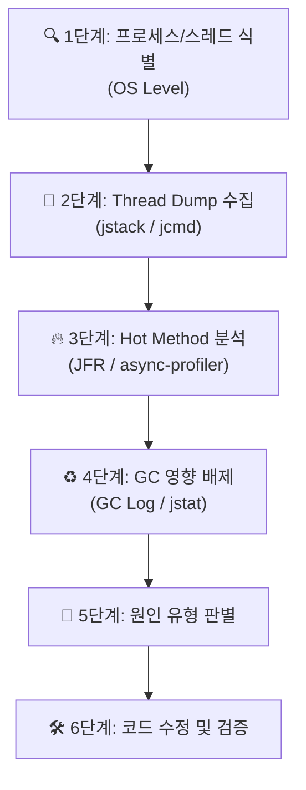
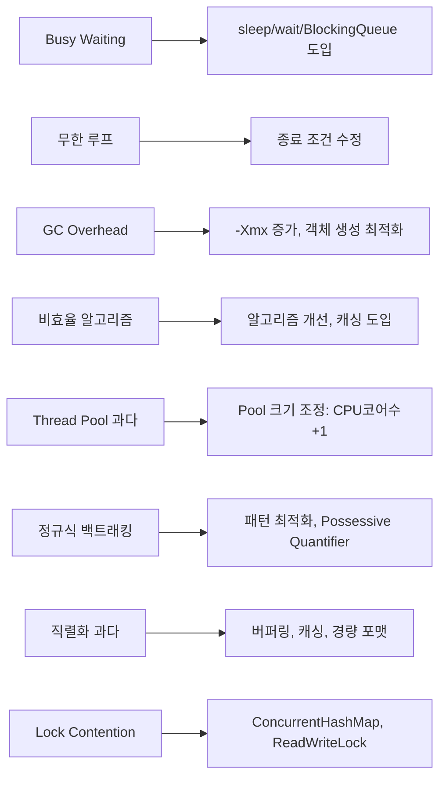
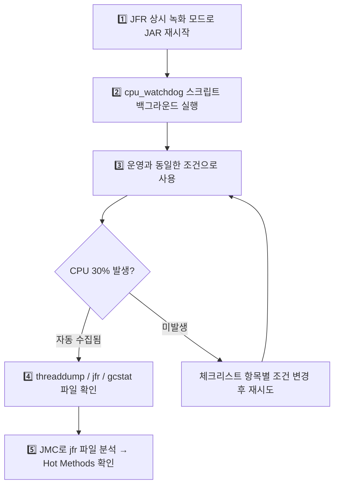

# Java JAR 애플리케이션 CPU 점유율 분석 보고서

> **작성일**: 2026-04-29  
> **대상 현상**: JAR 실행 후 CPU 점유율 30% 지속 발생  
> **목적**: 원인 파악을 위한 진단 방법론 검토 및 권장 절차 제시  
> **대상 JDK**: JDK 8 호환 검증 완료

---

## 🔖 JDK 8 호환성 요약

> [!IMPORTANT]
> 보고서의 모든 진단 방법은 **JDK 8에서 사용 가능**합니다. 단, JFR은 버전에 따라 옵션이 다릅니다.

| 도구 | JDK 8 사용 가능 | 비고 |
|:-----|:---------------|:----|
| `jps` | ✅ | JDK 8 기본 포함 |
| `jstack` | ✅ | JDK 8 기본 포함 |
| `jcmd Thread.print` | ✅ | JDK 8 기본 포함 |
| `jstat -gc` | ✅ | JDK 8 기본 포함 |
| `jvisualvm` | ✅ | **JDK 8에 기본 번들** (JDK 9+에서는 별도 다운로드) |
| **JFR** (Oracle JDK 8) | ⚠️ 조건부 | `-XX:+UnlockCommercialFeatures` 플래그 필요 |
| **JFR** (OpenJDK 8u262+) | ✅ | 플래그 없이 무료 사용 가능 |
| **JFR** (OpenJDK 8u261 이하) | ❌ | JFR 미포함, Thread Dump + jstat으로 대체 |
| `async-profiler` | ✅ | JDK 8+ 지원 (Linux 전용) |

> [!WARNING]
> **JRE만 설치된 환경**에서는 `jcmd`, `jstack`, `jstat` 등을 사용할 수 없습니다. 반드시 **JDK 설치 여부**를 먼저 확인하세요.

---

## 1. 현상 요약 및 접근 전략

CPU 점유율 30%는 단일 코어 기준 100%에 가까운 사용량(4코어 기준 ~120%, 8코어 기준 ~240% 중 30%)일 수 있으므로, **특정 스레드가 코어 하나를 과점유**하고 있을 가능성이 높습니다.

> [!IMPORTANT]
> 진단의 핵심은 **"어떤 스레드가, 어떤 코드를 실행하면서 CPU를 소비하는가"**를 특정하는 것입니다.

### 접근 전략 개요



---

## 2. 단계별 진단 절차

### 2.1 1단계: 문제 프로세스 및 스레드 식별 (OS 수준)

JAR 프로세스의 PID와 CPU를 과점유하는 스레드 TID를 먼저 확인합니다.

#### Linux 환경

```bash
# 1. Java 프로세스 PID 확인
jps -l
# 출력 예: 12345 my-application.jar

# 2. 해당 PID 내 스레드별 CPU 사용량 확인
top -H -p 12345
# 또는
ps -mo pid,lwp,stime,time,%cpu -p 12345

# 3. CPU 높은 스레드의 TID를 16진수로 변환 (jstack nid 매핑용)
printf "%x\n" <TID>
# 예: printf "%x\n" 12378  →  출력: 305a
```

#### Windows 환경

```powershell
# 1. Java 프로세스 PID 확인
jps -l

# 2. 프로세스별 CPU 사용률 확인
Get-Process -Name java | Select-Object Id, CPU, ProcessName

# 3. 스레드 수준 확인 (Process Explorer 또는 Performance Monitor 권장)
# - Sysinternals Process Explorer: 프로세스 더블클릭 → Threads 탭
# - 각 스레드의 CPU 사용량과 TID 확인 가능
```

> [!TIP]
> **Windows에서는 Sysinternals Process Explorer**를 사용하면 스레드별 CPU 사용량과 스택 트레이스를 GUI로 쉽게 확인할 수 있습니다.  
> 다운로드: https://learn.microsoft.com/sysinternals/downloads/process-explorer

---

### 2.2 2단계: Thread Dump 수집 및 분석

Thread Dump은 JVM 내 모든 스레드의 **현재 실행 위치(스택 트레이스)**를 캡처합니다.

```bash
# 방법 1: jstack (JDK 8 ✅ — 가장 안정적인 방법)
jstack -l <PID> > thread_dump_01.txt

# 방법 2: jcmd (JDK 8 ✅ — 동일하게 사용 가능)
jcmd <PID> Thread.print > thread_dump_01.txt
```

> [!IMPORTANT]
> **반드시 10초 간격으로 3~5회 반복 수집**하세요. 단일 스냅샷만으로는 우연히 해당 코드를 실행 중이던 것인지, 지속적으로 해당 코드에 머무르는 것인지 판별할 수 없습니다.

#### 분석 방법

```bash
# 스레드 덤프 반복 수집 스크립트 (Linux)
for i in 1 2 3 4 5; do
    echo "=== Dump $i at $(date) ===" >> thread_dumps.txt
    jcmd <PID> Thread.print >> thread_dumps.txt
    sleep 10
done
```

```powershell
# 스레드 덤프 반복 수집 스크립트 (Windows PowerShell)
for ($i = 1; $i -le 5; $i++) {
    "=== Dump $i at $(Get-Date) ===" | Out-File -Append thread_dumps.txt
    jcmd <PID> Thread.print | Out-File -Append thread_dumps.txt
    Start-Sleep -Seconds 10
}
```

#### Thread Dump 분석 포인트

1. **nid 매핑**: 1단계에서 확인한 16진수 TID로 `nid=0x305a` 형태로 검색
2. **RUNNABLE 상태 확인**: 동일 위치에서 반복적으로 `RUNNABLE` 상태인 스레드가 범인
3. **스택 트레이스 확인**: 해당 스레드가 실행 중인 Java 메서드와 라인 번호 확인

```
// Thread Dump 예시 - CPU 과점유 스레드
"worker-thread-3" #28 daemon prio=5 os_prio=0 tid=0x00007f... nid=0x305a runnable
   java.lang.Thread.State: RUNNABLE
        at com.example.service.DataProcessor.processLoop(DataProcessor.java:142)  ← 🔥 여기!
        at com.example.service.DataProcessor.run(DataProcessor.java:87)
        at java.lang.Thread.run(Thread.java:829)
```

---

### 2.3 3단계: Hot Method 프로파일링

Thread Dump이 스냅샷이라면, 프로파일링은 **일정 기간 동안의 통계**를 제공합니다.

#### 방법 A: Java Flight Recorder (JFR) — ⭐ 운영환경 최적

JFR은 JDK에 내장된 프로파일러로, **오버헤드 1% 미만**으로 운영환경에서도 안전하게 사용 가능합니다.

**JDK 8에서의 JFR 사용법 (버전별 분기):**

```bash
# ========================================
# Case 1: Oracle JDK 8 (상용 기능 잠금 해제 필요)
# ========================================
# 실행 시 JFR 활성화
java -XX:+UnlockCommercialFeatures -XX:+FlightRecorder \
     -XX:StartFlightRecording=duration=120s,filename=recording.jfr \
     -jar app.jar

# 이미 실행 중인 프로세스 (사전에 UnlockCommercialFeatures로 시작한 경우만)
jcmd <PID> JFR.start name=CPUProfile duration=120s filename=recording.jfr

# ========================================
# Case 2: OpenJDK 8u262+ (플래그 불필요, 무료)
# ========================================
java -XX:StartFlightRecording=duration=120s,filename=recording.jfr -jar app.jar

# 이미 실행 중인 프로세스
jcmd <PID> JFR.start name=CPUProfile duration=120s filename=recording.jfr

# ========================================
# 공통: 녹화 중지 / 상태 확인
# ========================================
jcmd <PID> JFR.stop name=CPUProfile
jcmd <PID> JFR.check
```

> [!CAUTION]
> **JFR을 사용할 수 없는 JDK 8 환경** (OpenJDK 8u261 이하, 상용 라이선스 없는 Oracle JDK 8)에서는 **Thread Dump + jstat 조합**으로 대체하세요. 이 조합만으로도 대부분의 CPU 문제 원인을 파악할 수 있습니다.

**분석 도구: JDK Mission Control (JMC)**
- JMC에서 `.jfr` 파일을 열면 다음 뷰를 통해 원인 파악:
  - **Thread CPU Load**: 스레드별 CPU 사용량 시계열 그래프
  - **Hot Methods**: CPU 시간 소비 상위 메서드 목록
  - **Method Profiling**: Flame Graph 형태의 호출 스택 시각화
  - **Lock Instances**: 경합(Contention)으로 인한 병목 확인

> [!NOTE]
> JMC 다운로드: https://jdk.java.net/jmc/  
> JDK 8용 JMC는 **JMC 5.x** 버전을 사용하세요 (JMC 7+는 JDK 11+ 전용).

#### 방법 B: async-profiler — Flame Graph 생성 (Linux 전용)

```bash
# async-profiler로 CPU 프로파일링 (30초간)
./profiler.sh -e cpu -d 30 -f flamegraph.html <PID>

# 결과: flamegraph.html을 브라우저에서 열어 시각적 분석
```

**Flame Graph 해석법:**

```
┌─────────────────────────────────────────────────┐
│            DataProcessor.processLoop()          │  ← 넓을수록 CPU 많이 소비
├────────────────────┬────────────────────────────┤
│ DataParser.parse() │   NetworkClient.send()     │
├──────┬─────────────┤                            │
│ ...  │  regex()    │                            │
└──────┴─────────────┴────────────────────────────┘
  X축: CPU 샘플 비율 (넓이 = CPU 시간)
  Y축: 호출 스택 깊이 (위 = 실제 실행 메서드)
```

#### 방법 C: VisualVM — GUI 기반 (개발/테스트 환경) — JDK 8 ✅ 번들 포함

```bash
# JDK 8에서는 jvisualvm이 기본 포함되어 있음 (JDK 9+에서는 별도 다운로드 필요)
jvisualvm

# 실행 중인 JVM에 연결 → Sampler 탭 → CPU 샘플링 시작
```

> [!TIP]
> **JDK 8의 장점**: VisualVM(`jvisualvm`)이 JDK에 기본 번들되어 있어 별도 설치 없이 바로 사용 가능합니다. JFR을 사용할 수 없는 환경에서 유용한 대안입니다.

> [!WARNING]
> VisualVM은 개발/테스트 환경에 적합합니다. **운영환경에서의 실시간 프로파일링은 Moderate~High 오버헤드**를 유발할 수 있으므로 JFR을 우선 사용하세요.

---

### 2.4 4단계: GC 영향 배제

CPU 과점유가 GC(Garbage Collection)로 인한 것인지 확인합니다.

```bash
# GC 상태 실시간 모니터링 (1초 간격) — JDK 8 ✅
jstat -gc <PID> 1000

# GC 로그 활성화 (JAR 실행 시)
# ⚠️ JDK 8 전용 문법 (-Xlog는 JDK 9+에서만 사용 가능)
java -verbose:gc -XX:+PrintGCDetails -XX:+PrintGCDateStamps -Xloggc:gc.log -jar app.jar

# 참고: JDK 9+ 문법 (JDK 8에서는 사용 불가)
# java -Xlog:gc*:file=gc.log:time,uptime,level,tags -jar app.jar

# Heap 정보 즉시 확인 — JDK 8 ✅
jcmd <PID> GC.heap_info
```

**GC가 원인인 경우의 징후:**
| 지표 | 정상 범위 | 이상 징후 |
|:-----|:---------|:---------|
| GC 빈도 | 수초~수분 간격 | 초당 수회 이상 |
| GC Pause 시간 | 수 ms | 수백 ms ~ 수 초 |
| GC에 소요되는 CPU 시간 | < 5% | > 20% |
| Heap 사용률 | 60~80% | 95%+ (지속적) |

---

### 2.5 5단계: 원인 유형 판별

수집된 데이터를 기반으로 아래 유형 중 해당하는 원인을 판별합니다.

| # | 원인 유형 | 특징 | 진단 단서 |
|:--|:---------|:-----|:---------|
| 1 | **Busy Waiting (바쁜 대기)** | `while(true)` 루프에서 조건 검사를 sleep 없이 반복 | Thread Dump에서 동일 위치에 `RUNNABLE` 상태 반복, `Thread.sleep()` 또는 `wait()` 없음 |
| 2 | **무한 루프** | 종료 조건이 충족되지 않는 루프 | Thread Dump에서 특정 반복문 내부에 고정, 루프 변수 미갱신 |
| 3 | **GC Overhead** | Heap 부족으로 GC 과다 실행 | `jstat`에서 GC 빈도 급증, Full GC 반복 |
| 4 | **비효율적 알고리즘** | O(n²) 이상의 연산, 대량 데이터 처리 | Hot Methods에서 특정 비즈니스 로직 메서드가 상위 |
| 5 | **Thread Pool 과다** | 불필요하게 많은 스레드가 활성화 | Thread Dump에서 다수의 `RUNNABLE` 스레드, Context Switching 과다 |
| 6 | **정규식 백트래킹** | 복잡한 정규식 패턴에 의한 CPU 폭발 | Hot Methods에서 `java.util.regex` 관련 메서드가 상위 |
| 7 | **직렬화/역직렬화** | JSON/XML 파싱의 과다 실행 | Hot Methods에서 Jackson, Gson 등의 parse/serialize 메서드 |
| 8 | **Lock Contention** | 다수 스레드가 동일 Lock을 경합 | Thread Dump에서 `BLOCKED` 상태 다수, JFR Lock Instances 확인 |

---

### 2.6 6단계: 원인별 해결 방향



---

## 3. 진단 도구 종합 비교

| 도구 | 유형 | 오버헤드 | 환경 | OS | 주요 용도 |
|:-----|:-----|:--------|:-----|:--|:---------|
| **jstack / jcmd Thread.print** | Thread Dump | 극히 낮음 (순간 pause) | 운영/개발 | 전체 | 특정 시점 스레드 상태 확인 |
| **JFR + JMC** | Sampling Profiler | < 1% | ⭐ **운영 최적** | 전체 | Hot Method, CPU Load, GC, Lock 종합 분석 |
| **async-profiler** | Sampling Profiler | < 1% | 운영/개발 | Linux | Flame Graph 생성, CPU Hotspot 시각화 |
| **VisualVM** | GUI Profiler | 중~높음 | 개발/테스트 | 전체 | 실시간 모니터링, CPU/Memory Sampler |
| **jstat** | GC 모니터링 | 극히 낮음 | 운영/개발 | 전체 | GC 빈도/시간 실시간 확인 |
| **top -H / Process Explorer** | OS 모니터링 | 없음 | 운영/개발 | Linux/Win | 스레드별 CPU 사용량 식별 |

---

## 4. 권장 진단 워크플로우

### 🎯 즉시 실행 가능한 원클릭 진단 (운영환경)

아래 순서대로 실행하면 **추가 도구 설치 없이** JDK 내장 도구만으로 원인을 파악할 수 있습니다.

```bash
# ===== Step 1: PID 확인 =====
jps -l

# ===== Step 2: JFR 녹화 시작 (2분간) =====
jcmd <PID> JFR.start name=CPUDiag duration=120s filename=cpu_diag.jfr

# ===== Step 3: 동시에 Thread Dump 5회 수집 =====
for i in 1 2 3 4 5; do
    jcmd <PID> Thread.print >> thread_dumps.txt
    echo "--- dump $i ---" >> thread_dumps.txt
    sleep 10
done

# ===== Step 4: GC 상태 확인 =====
jstat -gc <PID> 1000 10

# ===== Step 5: JFR 파일을 로컬로 가져와 JMC로 분석 =====
# cpu_diag.jfr 파일을 JMC (JDK Mission Control)로 열기
```

```powershell
# ===== Windows PowerShell 버전 =====

# Step 1: PID 확인
jps -l

# Step 2: JFR 녹화 시작 (2분간)
jcmd <PID> JFR.start name=CPUDiag duration=120s filename=cpu_diag.jfr

# Step 3: Thread Dump 5회 수집
for ($i = 1; $i -le 5; $i++) {
    jcmd <PID> Thread.print | Out-File -Append thread_dumps.txt
    "--- dump $i ---" | Out-File -Append thread_dumps.txt
    Start-Sleep -Seconds 10
}

# Step 4: GC 상태 확인
jstat -gc <PID> 1000 10

# Step 5: JFR 파일을 JMC로 분석
```

---

## 5. 운영환경 적용 시 주의사항

> [!CAUTION]
> 운영환경에서 진단 도구 사용 시 반드시 아래 사항을 확인하세요.

| # | 주의사항 | 상세 |
|:--|:---------|:-----|
| 1 | **권한 일치** | `jcmd`, `jstack`은 대상 프로세스와 **동일한 OS 사용자**로 실행해야 합니다 |
| 2 | **디스크 공간** | JFR 파일(`.jfr`)은 녹화 시간에 따라 수~수십 MB가 될 수 있습니다 |
| 3 | **JDK 버전 확인** | JFR은 JDK 11+ 무료, JDK 8u262+ 상용 라이선스 없이 사용 가능 |
| 4 | **JRE vs JDK** | `jcmd`, `jstack` 등은 **JDK에만 포함**됩니다. JRE만 설치된 환경에서는 사용 불가 |
| 5 | **네트워크 격리** | VisualVM 등 원격 연결 시 JMX 포트 개방 필요 → 보안 정책 확인 |
| 6 | **분석은 별도 머신에서** | JFR/Thread Dump 파일을 로컬로 복사하여 분석 (운영 서버 부하 방지) |

---

## 6. 기존 JPRM 도구 연계 가능성

> [!NOTE]
> 이전에 개발한 **JPRM (Java Process Resource Monitor)** 도구가 이 진단에 활용 가능합니다.

JPRM은 실시간 CPU/Memory 모니터링과 임계치 알림 기능을 제공하므로:
- **상시 모니터링**: CPU 30% 도달 시점과 패턴(지속적/간헐적)을 정확히 파악
- **알림 연동**: 임계치 초과 시 즉시 Thread Dump 자동 수집 트리거 가능
- **이력 추적**: 시계열 데이터로 CPU 상승 시점과 특정 이벤트의 상관관계 분석

JPRM과 JFR을 결합하면 **"언제 발생하는가"(JPRM) + "왜 발생하는가"(JFR)** 를 모두 커버할 수 있습니다.

---

## 7. 재현 불가 시 대응 전략

> [!IMPORTANT]
> 단순 JAR 실행만으로 CPU 30% 현상이 재현되지 않는 경우, **특정 조건에서만 발생하는 간헐적 문제**일 가능성이 높습니다. 이때는 "재현을 기다리는" 것이 아니라, **항상 녹화하면서 발생 순간을 자동으로 포착**하는 전략이 필요합니다.

### 7.1 JFR 상시 녹화 모드 (Always-On Recording)

JFR은 **링 버퍼 방식**으로 상시 녹화가 가능합니다. 최근 N분의 데이터를 항상 보관하다가, 문제 발생 시점에 파일로 덤프합니다.

```bash
# JAR 실행 시 JFR 상시 녹화 활성화 (최근 10분 데이터를 계속 유지)

# OpenJDK 8u262+ / JDK 11+
java -XX:StartFlightRecording=disk=true,maxsize=200m,maxage=10m,dumponexit=true,filename=emergency.jfr \
     -jar app.jar

# Oracle JDK 8
java -XX:+UnlockCommercialFeatures -XX:+FlightRecorder \
     -XX:StartFlightRecording=disk=true,maxsize=200m,maxage=10m,dumponexit=true,filename=emergency.jfr \
     -jar app.jar
```

```bash
# CPU 30% 현상 발생 시 → 즉시 이 명령으로 녹화 데이터 추출
jcmd <PID> JFR.dump filename=cpu_issue_captured.jfr

# 결과: 현상 발생 전후 10분간의 데이터가 파일에 저장됨 → JMC로 분석
```

### 7.2 CPU 임계치 자동 감지 스크립트

CPU가 임계치에 도달하면 **자동으로 Thread Dump + JFR Dump을 수집**하는 감시 스크립트를 상시 실행합니다.

#### Linux 버전

```bash
#!/bin/bash
# cpu_watchdog.sh - CPU 임계치 도달 시 자동 진단 수집
PID=$1
THRESHOLD=25  # 30% 도달 전에 감지하도록 여유값 설정
INTERVAL=5    # 5초마다 체크

echo "Monitoring PID=$PID, threshold=${THRESHOLD}%..."

while true; do
    CPU=$(ps -p $PID -o %cpu= | tr -d ' ')
    CPU_INT=${CPU%.*}

    if [ "$CPU_INT" -ge "$THRESHOLD" ]; then
        TIMESTAMP=$(date +%Y%m%d_%H%M%S)
        echo "⚠️ CPU ${CPU}% detected at $TIMESTAMP - collecting diagnostics..."

        # 1. Thread Dump 3회 수집
        for i in 1 2 3; do
            jstack -l $PID > "threaddump_${TIMESTAMP}_${i}.txt"
            sleep 3
        done

        # 2. JFR 데이터 덤프 (상시 녹화 모드인 경우)
        jcmd $PID JFR.dump filename="jfr_${TIMESTAMP}.jfr" 2>/dev/null

        # 3. GC 상태 스냅샷
        jstat -gc $PID > "gcstat_${TIMESTAMP}.txt"

        echo "✅ Diagnostics saved. Files: threaddump_*, jfr_*, gcstat_*"
        exit 0
    fi
    sleep $INTERVAL
done
```

```bash
# 사용법
chmod +x cpu_watchdog.sh
./cpu_watchdog.sh <PID> &
```

#### Windows PowerShell 버전

```powershell
# cpu_watchdog.ps1 - CPU 임계치 도달 시 자동 진단 수집
param([int]$PID, [int]$Threshold = 25)

Write-Host "Monitoring PID=$PID, threshold=${Threshold}%..."
while ($true) {
    $cpuPercent = (Get-Counter "\Process(java*)\% Processor Time" `
                   -ErrorAction SilentlyContinue).CounterSamples[0].CookedValue

    if ($cpuPercent -ge $Threshold) {
        $ts = Get-Date -Format "yyyyMMdd_HHmmss"
        Write-Host "⚠️ CPU ${cpuPercent}% detected - collecting diagnostics..."

        # 1. Thread Dump 3회 수집
        for ($i = 1; $i -le 3; $i++) {
            jstack -l $PID | Out-File "threaddump_${ts}_${i}.txt"
            Start-Sleep -Seconds 3
        }

        # 2. JFR 데이터 덤프
        jcmd $PID JFR.dump filename="jfr_${ts}.jfr" 2>$null

        # 3. GC 상태 스냅샷
        jstat -gc $PID | Out-File "gcstat_${ts}.txt"

        Write-Host "✅ Diagnostics saved."
        break
    }
    Start-Sleep -Seconds 5
}
```

```powershell
# 사용법
.\cpu_watchdog.ps1 -PID <PID> -Threshold 25
```

### 7.3 재현 조건 추적 체크리스트

단순 실행으로 재현이 안 될 때, 아래 조건을 하나씩 확인합니다.

| # | 의심 조건 | 확인 방법 | 대응 |
|:--|:---------|:---------|:-----|
| 1 | **특정 기능 호출 시** | API/기능별로 사용하면서 CPU 변화 관찰 | 기능별 부하 테스트 |
| 2 | **장시간 구동 후** | 수 시간~수일 운영 후 발생 여부 | JFR 상시 녹화로 대기 |
| 3 | **동시 접속/부하** | 다수 요청 동시 발생 시 | JMeter/wrk 등으로 부하 재현 |
| 4 | **특정 데이터 패턴** | 대량/특이 데이터 처리 시 | 운영 데이터 샘플로 테스트 |
| 5 | **스케줄러/타이머** | `@Scheduled`, `Timer` 주기 작업 트리거 시 | 로그에 스케줄러 실행 시점 기록 |
| 6 | **외부 연동 실패** | DB/네트워크 연결 실패 시 재시도 루프 | 의도적 연결 차단 테스트 |
| 7 | **특정 시간대** | 배치 작업, cron job 등 특정 시간 | 발생 시간대 패턴 분석 |

### 7.4 권장 적용 순서



---

## 8. 추가 분석 기법

### 8.1 Arthas — 무중단 실시간 진단 도구 (JDK 8 ✅)

Alibaba에서 개발한 **Arthas**는 JAR 재시작 없이 실행 중인 JVM에 붙어서 실시간 진단이 가능합니다.

```bash
# 설치 및 실행 (별도 설치 불필요, 다운로드 후 바로 사용)
curl -O https://alibaba.github.io/arthas/arthas-boot.jar
java -jar arthas-boot.jar
# → 실행 중인 Java 프로세스 목록에서 대상 선택
```

#### 핵심 명령어

```bash
# 1. 대시보드 — CPU/메모리/스레드 실시간 모니터링
dashboard

# 2. CPU 상위 스레드 즉시 확인 (상위 3개)
thread -n 3

# 3. 특정 스레드 스택 트레이스 확인
thread <threadId>

# 4. CPU 프로파일링 → Flame Graph 생성
profiler start
# ... (문제 재현 대기) ...
profiler stop --format flamegraph
# → HTML 파일 생성됨, 브라우저에서 열어 분석

# 5. 특정 메서드 실행 시간 추적 (100ms 이상만)
trace com.example.service.MyService processData '#cost > 100'

# 6. 메서드 호출 횟수/시간 통계
monitor com.example.service.MyService processData -c 10

# 7. 종료 시 반드시 정리 (바이트코드 원복)
reset
quit
```

> [!TIP]
> **Arthas의 장점**: `jstack`이나 JFR과 달리 **특정 메서드의 실행 시간, 호출 빈도, 파라미터 값**까지 실시간으로 확인 가능합니다. "이 메서드가 느린 것 같다"는 의심이 있을 때 즉시 검증할 수 있습니다.

> [!WARNING]
> `trace`나 `watch` 같은 명령은 바이트코드를 수정하므로, 고빈도 호출 메서드에 적용하면 오버헤드가 발생할 수 있습니다. 진단 후 반드시 `reset` 명령으로 원복하세요.

### 8.2 Spring Boot Actuator 활용 (해당 시)

대상 JAR이 **Spring Boot 애플리케이션**인 경우, Actuator 내장 엔드포인트를 활용할 수 있습니다.

```properties
# application.properties에 추가
management.endpoints.web.exposure.include=health,metrics,threaddump
management.server.port=8081  # 관리용 별도 포트 (보안)
```

```bash
# CPU 사용률 확인
curl http://localhost:8081/actuator/metrics/process.cpu.usage

# JVM 스레드 수 확인
curl http://localhost:8081/actuator/metrics/jvm.threads.live

# Thread Dump (jstack과 동일한 결과를 HTTP로 획득)
curl http://localhost:8081/actuator/threaddump
```

| 엔드포인트 | 용도 |
|:-----------|:-----|
| `/actuator/metrics/process.cpu.usage` | 프로세스 CPU 사용률 (0.0~1.0) |
| `/actuator/metrics/system.cpu.usage` | 시스템 전체 CPU 사용률 |
| `/actuator/metrics/jvm.threads.live` | 현재 활성 스레드 수 |
| `/actuator/metrics/jvm.threads.peak` | 피크 스레드 수 |
| `/actuator/threaddump` | HTTP 기반 Thread Dump |
| `/actuator/metrics/jvm.gc.pause` | GC 일시정지 시간 |

> [!NOTE]
> Actuator의 장점은 **원격에서 HTTP로 진단 데이터를 수집**할 수 있다는 것입니다. Prometheus + Grafana와 연동하면 CPU 추이를 시계열 그래프로 볼 수 있습니다.

### 8.3 소스코드 정적 분석 — CPU 과점유 패턴 검색

런타임 진단과 병행하여, **소스코드에서 CPU 과점유를 유발하는 전형적 패턴**을 직접 검색합니다.

| # | 의심 패턴 | 검색 키워드 | 위험도 |
|:--|:---------|:-----------|:------:|
| 1 | **Busy Waiting** | `while (true)`, `while(true)`, `for (;;)` 에서 `sleep`/`wait`/`take` 없는 경우 | 🔴 |
| 2 | **GC 압박** | `new byte[]`, `String +` 반복, `toArray()` 루프 내 호출 | 🟡 |
| 3 | **정규식 폭발** | `Pattern.compile` 루프 내 호출, `(.*)`, `(a+)+` 등 중첩 수량자 | 🔴 |
| 4 | **동기화 병목** | `synchronized` 블록 내 I/O, DB 호출 | 🟡 |
| 5 | **스레드 과생성** | `new Thread()` 루프 내 호출, `Executors.newCachedThreadPool()` | 🟡 |
| 6 | **재시도 무한루프** | `catch` 블록에서 `continue`/재호출, backoff 없는 retry | 🔴 |

```bash
# 소스코드에서 의심 패턴 검색 예시 (grep)
# Busy Waiting 패턴
grep -rn "while\s*(true)" src/ --include="*.java"
grep -rn "for\s*(;;\s*)" src/ --include="*.java"

# sleep 없는 루프 확인 (위 결과에서 해당 파일 내 sleep/wait 존재 여부 확인)

# 정규식 루프 내 컴파일
grep -rn "Pattern.compile" src/ --include="*.java"

# 무한 재시도
grep -rn "catch.*continue" src/ --include="*.java"
```

> [!TIP]
> 코드 리뷰 시 **`while(true)` 루프 주변에 `Thread.sleep()`, `BlockingQueue.take()`, `wait()`, `LockSupport.park()` 중 하나라도 없다면** CPU 과점유의 유력 후보입니다.

---

## 9. 결론 및 권장사항

### JDK 8 환경별 권장 진단 경로

| 환경 | 최적 경로 | 소요시간 |
|:-----|:---------|:--------|
| **OpenJDK 8u262+** | `jps` → `jcmd JFR.start` → JMC Hot Methods | ~5분 |
| **Oracle JDK 8 (상용)** | `jps` → `jcmd JFR.start` (UnlockCommercialFeatures) → JMC | ~5분 |
| **JFR 사용 불가** | `jps` → `jstack` 5회 수집 → nid 매핑 + `jstat -gc` | ~10분 |
| **개발/테스트 환경** | `jvisualvm` → Sampler CPU 탭 | ~3분 |

### 즉시 조치 (금일 적용 가능)

1. **`java -version`** 으로 JDK 버전 및 배포판 확인 (Oracle/OpenJDK, 빌드 번호)
2. JFR 가능 시: **`jcmd <PID> JFR.start`** → JMC Hot Methods 분석
3. JFR 불가 시: **`jstack -l <PID>`** 를 10초 간격 5회 수집 → RUNNABLE 스레드 확인
4. **`jstat -gc <PID> 1000`** 로 GC가 원인인지 배제

### 중장기 조치

| 기간 | 조치 | 기대 효과 |
|:-----|:-----|:---------|
| 단기 (1주) | Thread Dump/JFR로 원인 코드 특정 및 수정 | CPU 점유율 정상화 |
| 중기 (2~4주) | JPRM 상시 모니터링 + 임계치 알림 설정 | 재발 즉시 감지 |
| 장기 | CI/CD에 성능 테스트 게이트 추가 | 배포 전 CPU 이상 사전 차단 |

> [!TIP]
> **JDK 8에서 가장 확실한 방법**: `jstack` + `jstat` 조합은 어떤 JDK 8 배포판에서든 100% 동작합니다. JFR을 사용할 수 없더라도 이 조합만으로 대부분의 CPU 문제를 진단할 수 있습니다.
